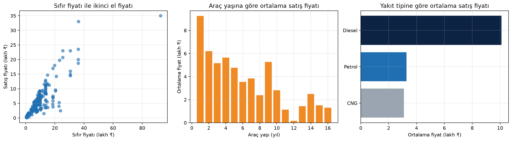
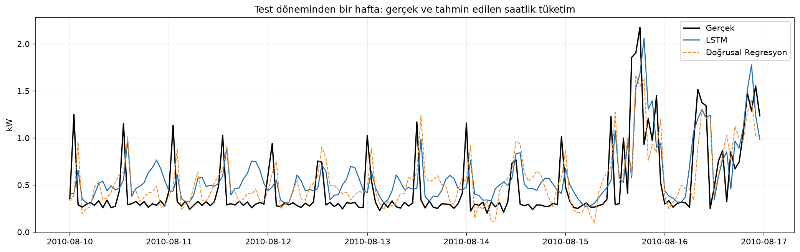

# Yapay Zeka Portfolyosu

**Software Persona Yapay Zeka Mesleki Gelişim Programı · 30. Dönem** kapsamında hazırlanan proje envanterleri.
Her not defteri Google Colab'da doğrudan açılıp **Çalışma Zamanı → Tümünü çalıştır** ile baştan sona yeniden üretilebilir.

| # | Proje | Yöntem | Öne çıkan sonuç | Not defteri |
|---|---|---|---|---|
| 1 | [İkinci El Araç Fiyat Tahmini](1_Python_Arac_Fiyat) | Pandas, EDA, Doğrusal Regresyon, Karar Ağacı | Test R² = 0,785 · MAE = 1,38 lakh ₹ | [](https://colab.research.google.com/github/mirhanserim/yapay-zeka-portfolyo/blob/main/1_Python_Arac_Fiyat/Arac_Fiyat_Tahmini.ipynb) |
| 4 | [Hanehalkı Elektrik Tüketimi Tahmini](4_MLDL_Enerji) | Zaman serisi, LSTM, GRU (PyTorch), temel model karşılaştırması | GRU: Test MAE = 0,324 kW · R² = 0,550 | [](https://colab.research.google.com/github/mirhanserim/yapay-zeka-portfolyo/blob/main/4_MLDL_Enerji/Enerji_Tuketimi_Tahmini.ipynb) |

Web geliştirme projesi ayrı bir depoda: [basvuru-takip](https://github.com/mirhanserim/basvuru-takip)

## 1 · İkinci El Araç Fiyat Tahmini
Aracın sıfır fiyatı, yaşı, kilometresi, yakıt tipi, vites ve satıcı türünden ikinci el satış fiyatını tahmin eden uçtan uca proje:
problem tanımı → veri temizleme → keşifçi analiz → model → değerlendirme → `tahmin_et()` mini uygulaması.
Veri: *Vehicle Dataset from CarDekho* (Kaggle), 301 ilan.



## 4 · Hanehalkı Elektrik Tüketiminin Saatlik Tahmini
2,07 milyon dakikalık ölçümden saatlik seriye geçip son 24 saatten sonraki saati tahmin eden derin öğrenme çalışması.
Naif, mevsimsel naif ve doğrusal regresyon temel modelleri ile LSTM ve GRU karşılaştırıldı; kronolojik bölme ve erken durdurma kullanıldı.
Veri: UCI *Individual Household Electric Power Consumption* (CC BY 4.0), not defteri tarafından otomatik indirilir.

| Model | MAE (kW) | RMSE (kW) | R² |
|---|---|---|---|
| Naif (önceki saat) | 0,366 | 0,566 | 0,342 |
| Doğrusal Regresyon | 0,348 | 0,488 | 0,511 |
| LSTM | 0,344 | 0,478 | 0,530 |
| **GRU** | **0,324** | **0,467** | **0,550** |



## Yerelde çalıştırma
```bash
python -m venv .venv && source .venv/bin/activate
pip install -r requirements.txt
jupyter notebook
```

Muhammed Mirhan Serim · [mmserim.com.tr](https://mmserim.com.tr)
